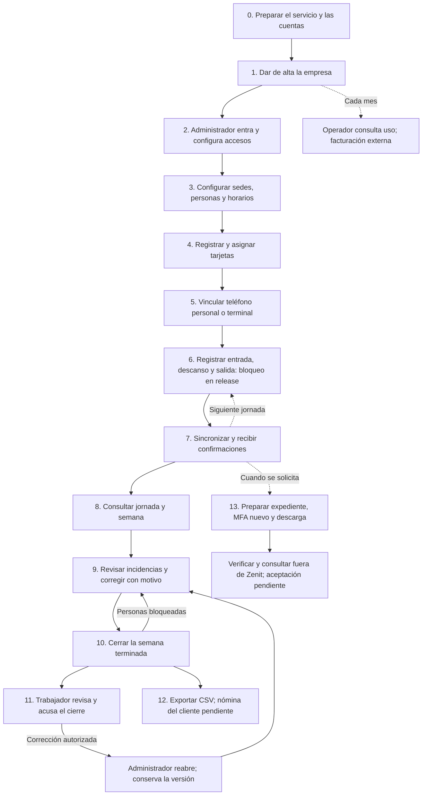

# Flujo del producto y lo que falta para terminarlo

**Actualización del 5 de noviembre:** el mapa de uso sigue aplicando; los
estados de su corte del día 4 son históricos. Ya están implementadas las
propuestas Q10–Q13 (captura existente durante suspensión, baja con fecha y
revocación/fin de horario, supervisores por sedes), las reglas diarias/semanales
de jornada y recuperación OTP con 12 códigos. Candidato local 0.18.0,
V012/V013; 85 unitarias/101 integraciones backend, 216 web y 14 identidad
aprobadas. VPS privada por cliente y respaldo S3 sustituyen el modelo anterior;
quedan provisión, SMTP, pruebas físicas y aceptación pública. [Estado por las
17 tareas](bitacora-trabajo.md#5-de-noviembre-de-2026--ejecución-de-las-17-tareas-por-necesidad-inmediata).
Para una persona sin conocimientos técnicos: [guía de demo](guia-demo-cliente.md)
y [PDF](../output/pdf/guia-demo-zenit-cliente.pdf). No se habilita captura release
ni purga por estos cambios.

Estado revisado el **4 de noviembre de 2026**, sobre `main/645174d`, API
0.17.0. El orden representa el uso de Zenit: preparar una empresa, registrar
su asistencia y obtener resultados. Cada jornada y cada semana repiten su
parte del ciclo.

El recorrido con datos ficticios tiene implementación desde el alta hasta
el cierre, CSV y expediente. **El primer bloqueo directo de la app móvil
para uso real aparece al registrar asistencia: la captura está limitada a
debug y falta autenticar tarjetas reales.** También hay pendientes de
acceso, reglas de jornada, evidencia y operación antes de usar datos reales.

En este documento, **implementado** significa que hay código conectado al
sistema; no equivale a aceptación del usuario ni a verificación de la
versión publicada. **Parcial** indica qué capacidad o definición falta.
Los números de tarea remiten a la columna **Orden** de
[Tareas críticas primero](tareas-criticas-primero.md).

## Línea del tiempo de uso

El acuse y el CSV son salidas del cierre: el CSV puede incluir cierres sin
acuse. El expediente se solicita cuando se necesita y contiene la evidencia
disponible a su fecha de corte; no exige terminar un CSV. Respaldo, permisos,
auditoría y conservación acompañan todo el recorrido.

## Antes del primer día de trabajo

| Paso | Quién y dónde | Qué ya se puede hacer | Qué falta para darlo por terminado |
| --- | --- | --- | --- |
| **0. Preparar el servicio** | Operación de fastSolution | Hay configuración de despliegue, HTTPS, identidad, base de datos, migraciones y herramientas de respaldo/restauración | **Parcial para producción:** destino definitivo, custodia, respaldo externo automático y recuperación comprobada en ese destino. Faltan verificaciones públicas de versión, imágenes, continuidad y capacidad. Tareas 1, 6, 8, 12 y 18 |
| **1. Crear la empresa** | Operador del servicio, portal → Empresas | Dar de alta la empresa y su primer administrador; separar sus datos de otras empresas; consultar estado, suspender/reactivar y consultar uso mensual | Aceptación pública/del usuario. Elegir los efectos definitivos de suspensión y baja; hoy suspender también detiene captura. Tareas 5 y 16 |
| **2. Entrar y dar accesos** | Administrador y personas invitadas, portal e identidad | Vincular una cuenta a la invitación, entrar con contraseña y segundo factor, asignar roles y exigir cambio de contraseña a cuentas activas vinculadas | **Parcial en operación:** creación/recuperación de cuentas, correo SMTP, recuperación de contraseña olvidada y del operador, y comprobación efectiva en el ambiente público. Exigir cambio de contraseña no recupera por sí solo una contraseña olvidada. Tarea 2 |
| **3. Preparar la empresa y el padrón** | Administrador/RH, portal | Configurar zona y semana, sedes/geocercas, empleados, importación CSV, horarios y sus asignaciones. Programar cambios de comida con aviso y fecha futura, o cancelarlos antes de su vigencia | El horario asignado todavía no produce por sí solo retardos, faltas o salidas anticipadas. Faltan criterios y flujo operativo de vacaciones/incapacidades. Falta validar visualmente el cambio de comida en teléfono y completar accesibilidad manual. Tareas 13 y 17 |
| **4. Entregar tarjetas** | Administrador/RH, portal → Tarjetas | Registrar inventario, asignar/reemplazar tarjetas y revocarlas; hay herramientas Android MF1K de ejemplo | **Bloqueo para tarjetas reales:** elegir tecnología, autenticar la tarjeta al marcar, integrar backend y custodiar claves. Leer NFC o preparar una tarjeta de ejemplo no completa esa autenticación. Tarea 4 |
| **5. Vincular el dispositivo** | Administrador/RH emite código; persona lo introduce en Android | Activar con código temporal de un uso y clave del dispositivo. Personal queda ligado a una persona; terminal a una sede. Gestionar sesión y revocación | Aceptación del recorrido en el ambiente publicado y con la combinación final de teléfono/tarjeta. Una terminal no ofrece consulta personal de semana ni acuse. El trabajador puede usar su dispositivo enrolado sin una cuenta del portal |

En Android, **Administración** abre el portal real del servidor público.
La gestión de empresa se realiza allí. **Mi asistencia** abre la aplicación
operativa de captura y consulta. La opción debug **Ver presentación con
ejemplos** usa datos locales: sus históricos, retardos y vacaciones no
acreditan funciones conectadas. Véase [el alcance móvil](alcance-producto-movil.md).

## Durante cada jornada

| Paso | Quién y dónde | Qué ya está implementado | Qué falta para darlo por terminado |
| --- | --- | --- | --- |
| **6. Registrar asistencia** | Trabajador con teléfono personal o tarjeta en una terminal | En el flujo debug: lectura NFC, ubicación puntual, firma del dispositivo y registro de entrada/salida; inicio/fin de descanso cuando la política lo permite | **Bloqueo de release:** `AttendanceRepository.capture()` exige `BuildConfig.DEBUG`. Falta autenticación real de tarjeta; no basta quitar esa comprobación. Falta validar el aviso y la entrada en vigor del cambio de comida sin red en teléfono real. Tareas 4 y 13 |
| **7. Sincronizar y confirmar** | Android y backend | Guardar pendientes cifrados sin conexión, enviar después, evitar duplicados, renovar sesión y mostrar recibos de aceptación, incidencia o rechazo | Validación final en condiciones reales, incluido corte físico de conectividad. **Retención parcial:** falta aprobar qué se conserva y cuánto, e implementar purga que proteja pendientes y evidencia. Tarea 10/Q14 |
| **8. Ver jornada y semana** | Trabajador en Mi semana/Mi asistencia; administración, RH, supervisor o auditor según permisos | Consultar tramos, minutos, descansos, alertas, incidencias y cierre; la política de comida corresponde a la fecha de cada jornada | Aprobar criterios y casos esperados del cálculo, implementando las diferencias que se acuerden y conservando históricos. No hay clasificación operativa completa de puntualidad, faltas y vacaciones. Tareas 3 y 17 |
| **9. Atender lo que no cuadra** | Administrador/RH/supervisor, portal → Incidencias | Filtrar, asignar y resolver; justificar, confirmar o ajustar agregando/excluyendo/cambiando un marcaje con motivo y conservando el original | Resolver alcance definitivo del supervisor y efectos de baja/suspensión/tipo de marca. Hoy el supervisor atiende toda su empresa. Cerrar aceptación de los recorridos públicos. Tareas 5 y 9 |

La cola sin conexión permite continuar dentro de los límites de la sesión
del dispositivo. Una sesión vencida o sin capacidad requiere renovación;
no se promete captura indefinida sin red.

## Al terminar la semana

| Paso | Quién y dónde | Qué ya está implementado | Qué falta para darlo por terminado |
| --- | --- | --- | --- |
| **10. Cerrar la semana** | Administrador/RH, portal → Cierres | Cierre directo, corridas para conjuntos grandes y cierre programado. Identificar personas bloqueadas y motivos; atenderlas y repetir. Reabrir con motivo sólo desde administración, conservando la versión anterior | Aceptación final de los cálculos, reglas y operación publicada. El cierre técnico existente no sustituye aprobar las reglas de jornada. Tareas 3, 9 y 15 |
| **11. Revisar y acusar** | Trabajador, teléfono personal o portal → Mi asistencia | Ver el cierre, expresar conformidad u objeción y recuperar el acuse desde el servidor. Una reapertura conserva la versión y sus acuses; el nuevo cierre tiene otra versión | Definir y aceptar el texto/documento, la evidencia y su conservación, incluidos límites del expediente. La objeción no reabre automáticamente: la corrección pasa por quien administra. Tareas 3 y 15; Q07/Q14 |
| **12. Exportar para uso administrativo** | Administrador/RH/auditor, portal → Exportes | Solicitar CSV de cierres vigentes, consultar preparación, descargar una vez y guardar manifiesto/huella. Incluye el estado de acuse disponible | **Parcial hacia nómina:** no existe todavía el conector ni el formato aceptado por el primer sistema de nómina del cliente. Falta identificar ese sistema, integrar y validar su archivo/sincronización. Tarea 19 |

Este ciclo se repite cada semana. El operador del servicio puede consultar
el **uso mensual** de la empresa mediante conteos; el cobro y la factura se
gestionan fuera de Zenit. Ese conteo no es un módulo de nómina.

## Cuando se necesita evidencia o salir del servicio

**13. Obtener el expediente empresarial.** Administración concede un
permiso explícito por cuenta. La persona autorizada solicita la preparación,
consulta su estado/manifiesto y realiza una nueva verificación de identidad
con segundo factor antes de descargar. La autorización y la descarga son de
un uso; una entrega consumida e interrumpida requiere otra solicitud.

Esto **ya está implementado** en E1–E5. E6 técnica también permite verificar
integridad y consultar el archivo fuera de Zenit, sin su base de datos ni
su servicio. No hay que desarrollar otra vez la descarga o el portal.

**Falta el cierre integral de conservación/recuperación:** aceptación del
responsable, decisiones Q07/Q14 y criterios de evidencia. El manifiesto
declara los datos ausentes: por ejemplo, sobres originales de rechazos que
el servidor no guardó y evidencia sólo local de Android. El verificador no
puede reconstruirlos. El expediente de una empresa y el respaldo operativo
de toda la instalación son entregas distintas; el expediente no restaura
una instalación ni habilita borrado del origen.
[Alcance y límites de E6](entrega-expediente-e6.md).

## Dónde se interrumpe hoy el producto terminado

| Punto del recorrido | Pendiente concreto | Tipo de trabajo |
| --- | --- | --- |
| Antes del primer acceso operativo | Cuentas, recuperación y SMTP comprobados | Definición/configuración y aceptación; tarea 2 |
| Al marcar en Android release | Tarjeta autenticada e integración segura de captura | Desarrollo y prueba con hardware; tarea 4. Es el primer bloqueo directo del flujo móvil real |
| Al interpretar la asistencia | Reglas definitivas de jornada/acuse y comparación con horarios/ausencias | Decisiones y desarrollo con casos aprobados; tareas 3, 5 y 17 |
| Al entregar resultados a nómina | Conector y formato del sistema del cliente | Integración pendiente; tarea 19 |
| Al conservar o entregar evidencia | Aceptación integral E6 y retención Android | Decisión, aceptación y purga protegida pendiente; tareas 10 y 15 |
| Antes de operar con datos reales | Producción administrada, respaldo externo y recuperación efectiva | Infraestructura y comprobación; tareas 1 y 6. Acompañan todo el ciclo |

Además faltan aceptación pública/del usuario, accesibilidad manual y pruebas
finales de capacidad, teléfono y despliegue. Se mantienen **17 tareas
globales abiertas y seis P0**; este mapa las sitúa dentro de la experiencia
del producto, sin convertir una función implementada en una función aceptada.

## Estado del entorno y evidencia de esta revisión

- **Docker comprobado:** cliente y servidor responden en el contexto
  `desktop-linux`, motor 29.9.2 y Docker Desktop 4.97.0. La consulta necesitó
  permisos fuera del sandbox; la inicialización ya está disponible.
- **Servicios locales detenidos:** `docker compose ps --all` muestra
  backend, base de datos, identidad y portal en `Exited`. Que Docker esté
  iniciado no significa que Zenit esté sirviendo peticiones. No se
  arrancaron, reconstruyeron ni migraron esos servicios en esta revisión.
- **Pruebas anteriores de esta sesión:** 72 unitarias backend, 214 del
  portal y compilación web aprobadas; identidad estática: cuatro aprobadas
  y dos omitidas. No se repitieron integración, identidad real, Android ni
  aceptación pública al comprobar Docker.

Referencias comprobadas: [contrato actual](../contracts/openapi.yaml),
[navegación del portal](../web/src/Workspace.tsx),
[entrada de Android](../android/app/src/main/kotlin/mx/fastsolution/zenit/mobile/WelcomeActivity.kt),
[captura y cola Android](../android/app/src/main/kotlin/mx/fastsolution/zenit/mobile/data/AttendanceRepository.kt),
[selección de cierres para CSV](../backend/src/main/kotlin/mx/fastsolution/zenit/export/Exports.kt),
[casos de uso](casos-de-uso.md) y [tareas pendientes](TareasPendientes.md).

Para ejecutar el recorrido con peticiones y datos ficticios, consultar
[Recorrido completo](recorrido-completo.md). Para elegir el siguiente trabajo,
consultar [el contexto de reanudación](TareasPendientes.md#contexto-para-reanudar--4-de-noviembre-de-2026).
