# Guía de demostración

Recorrido completo de Zenit para presentarlo en el ambiente publicado
(<https://zenit.fastsolution.com.mx>), con el portal y la app Android, sobre
una empresa ficticia que se siembra y se reinicia con un solo comando.

Para quien presenta y para quien la prepara. El PDF con los mismos pasos se
genera con `bash deploy/servidor/demo/demo.sh pdf` y queda en
[`output/pdf/guia-de-demostracion.pdf`](../output/pdf/guia-de-demostracion.pdf).

> Todo lo que se ve es ficticio: la empresa Distribuidora Altiplano, sus 16
> personas y las cuentas `demo.…@zenit.example`. No se cargan datos de
> personas reales en este ambiente.

## El recorrido

| Parte | Qué se muestra | Dónde | Minutos |
| --- | --- | --- | --- |
| 1. Acceso | Primer ingreso de una cuenta nueva y entrada con código | Portal | 6 |
| 2. Panel | Lo que pasa hoy y la semana anterior | Portal | 3 |
| 3. Asistencia | La semana de todos y la ficha de una persona | Portal | 5 |
| 4. Incidencias | Qué detectó el sistema y cómo se resuelve | Portal | 5 |
| 5. Cierres | Cerrar la semana: la base de la nómina | Portal | 5 |
| 6. Padrón | Importar personal con un archivo y dar de alta a mano | Portal | 6 |
| 7. Terminal y tarjetas | Activar un teléfono como terminal, preparar tarjetas y marcar | Portal y teléfono A | 12 |
| 8. Teléfono personal | La semana de una persona y su acuse | Teléfono B | 4 |
| 9. Reportes | Nómina en PDF y CSV, bitácora y expediente | Portal | 6 |
| 10. Supervisión | Una cuenta que sólo ve su sede | Portal | 3 |
| 11. Configuración | Sedes, horarios, comida, usuarios y perfil | Portal | 3 |

Unos 55 minutos. Las partes 10 y 11 se pueden recortar.

## Qué hace falta

| Qué | Para qué |
| --- | --- |
| Una computadora con Docker y el repositorio | Correr `demo.sh`: siembra, reinicio, capturas y PDF |
| `deploy/servidor/.env.despliegue` | El acceso SSH del despliegue y `DEMO_SECRETOS` (ver abajo) |
| El teléfono de quien presenta, con una app de autenticación | Los códigos de las cuentas: FreeOTP, Microsoft o Google Authenticator |
| Teléfono A, Android con NFC | La terminal de la sede Matriz Centro |
| Teléfono B, Android con NFC | El teléfono personal de una persona |
| La app de Zenit instalada en los dos | El APK de la versión vigente de `main`, con las tarjetas del piloto |
| Tres tarjetas MIFARE Classic 1K y un marcador | Dos se preparan en vivo; la tercera, de reserva |
| [`padron-demo.csv`](guia-de-demostracion/padron-demo.csv) en la computadora | La importación en vivo |

### Una sola vez: preparar

1. En `deploy/servidor/.env.despliegue` (fuera de Git) agregar
   `DEMO_SECRETOS`, una carpeta local fuera del repositorio, por ejemplo
   `D:/Proyectos/secretos/fastsolution/zenit/demo`. El ejemplo está en
   `deploy/servidor/despliegue.env.ejemplo`.
2. Correr:

   ```bash
   bash deploy/servidor/demo/demo.sh preparar
   ```

   Genera en `DEMO_SECRETOS` las cuentas de la demostración
   (`cuentas-demo.md`, `cuentas.json`, un QR por cuenta) y la clave con que el
   servidor firma las tarjetas del piloto. La clave se instala en el servidor
   sólo si no tiene una; las siguientes veces conserva todo.
3. Abrir `cuentas-demo.md` y escanear con la app de autenticación del
   teléfono de quien presenta los cuatro QR (`qr-administracion.png`,
   `qr-rh.png`, `qr-supervision.png`, `qr-auditoria.png`). Las contraseñas
   están en ese archivo: no se copian a ningún otro lado.
4. Instalar la app en los dos teléfonos y darles bloqueo de pantalla; la app
   no se vincula sin él.

El servidor tiene que tener encendidas las tarjetas del piloto
(`CAPTURE_PILOT_CARDS=true` en `deploy/servidor/zenit/servidor.env`, llega
con el despliegue). `demo.sh estado` dice si la clave está presente.

### El día: reiniciar

La mañana de la demostración, entre las 7:30 y las 8:30:

```bash
bash deploy/servidor/demo/demo.sh reiniciar
```

Borra la empresa de demostración con todo lo que se haya hecho en ella,
vuelve a crear las cinco cuentas y siembra la jornada de ayer. Tarda unos
tres minutos y termina con los conteos:

```text
personas: 16
dispositivos activos: 11
marcajes: 28
clave de las tarjetas del piloto: presente
```

Por qué a esa hora:

- **Ayer tiene que verse como un día normal.** Las marcas sembradas empiezan
  media hora después de la hora en que se corre: a las 7:30 quedan de 8:00 en
  adelante. Sembradas después de las 11:30, las jornadas terminan de noche,
  Zenit las cuenta como mixtas (máximo de 7 h 30) y a todos les sale media
  hora extra; la siembra lo avisa.
- **Una marca que llega con más de 24 horas de retraso es una incidencia**
  («sincronizada tarde»). La siembra manda las marcas de ayer dentro de esas
  24 horas; si se corre la tarde anterior, salen de más.
- **La semana se acomoda sola.** El día de inicio de semana de la empresa
  pasa a ser el de hoy, para que ayer quede en una semana terminada que se
  pueda cerrar en vivo.

Si se presenta lejos del Centro de la Ciudad de México, poner en
`.env.despliegue` las coordenadas del lugar (`DEMO_LATITUD` y
`DEMO_LONGITUD`) antes de reiniciar: ahí queda la sede Matriz Centro y las
marcas en vivo caen dentro de ella.

### Quince minutos antes

- [ ] `bash deploy/servidor/demo/demo.sh estado` da los conteos de arriba.
- [ ] El navegador en <https://zenit.fastsolution.com.mx>, con una ventana
      privada a la mano para las otras cuentas.
- [ ] La app de autenticación con las cuatro cuentas de «Zenit Demo».
- [ ] Teléfonos A y B con NFC, ubicación y datos encendidos, la app sin
      vincular.
- [ ] Las tres tarjetas y el marcador.
- [ ] `padron-demo.csv` descargado.

## Las cuentas

| Cuenta | Persona | Papel | Se usa en |
| --- | --- | --- | --- |
| `demo.administracion@zenit.example` | Mariana Ortiz | Administración | Casi todo el recorrido |
| `demo.nueva@zenit.example` | Sofía Herrera | RH, cuenta nueva | El primer ingreso en vivo (parte 1) |
| `demo.supervision@zenit.example` | Laura Gil | Supervisión de Bodega Norte | Parte 10 |
| `demo.rh@zenit.example` | Rocío Navarro | RH | De reserva |
| `demo.auditoria@zenit.example` | Arturo Méndez | Auditoría, sólo consulta | De reserva |

Las contraseñas y los QR están sólo en `DEMO_SECRETOS/cuentas-demo.md`. La
cuenta nueva sirve para un solo primer ingreso: después de usarla, el
siguiente `reiniciar` la deja como nueva otra vez.

## La empresa sembrada

Distribuidora Altiplano tiene dos sedes, Matriz Centro (oficina, radio de
200 m) y Bodega Norte (radio de 150 m), dos horarios, Oficina L–V (9:00 a
18:00, una hora de comida) y Matutino 6 días (7:00 a 15:00, media hora), una
terminal activada en cada sede y 16 personas. Lo que le pasó ayer a cada una
es lo que se cuenta en el recorrido:

| Persona | Ayer | Lo que muestra |
| --- | --- | --- |
| Ana Torres, Raúl Ortega, Sandra Morales, Fernando Cruz, Verónica Paz | Marcaron en la terminal de su sede | Una jornada normal |
| Carmen Vega, Marco Ibarra, Gabriela Ríos | Marcaron con su teléfono | La modalidad personal |
| Jorge Ramírez, Luis Herrera | Se quedaron casi tres horas de más | Tiempo extra |
| Andrea Lozano | Entró marcando fuera de su sede | Incidencia «marcó en otra sede» |
| Patricia Núñez | Marcó dos veces la entrada | Incidencia «marca duplicada» |
| Héctor Salinas | Su teléfono mandó las marcas un día después | Incidencia «sincronizada tarde» |
| Diego Castañeda | Entró y no marcó la salida | Un tramo abierto que bloquea su cierre |
| Óscar Mendoza, Lucía Fuentes | No tienen tarjeta | A quién darle una tarjeta en vivo |

Además: la supervisión está limitada a Bodega Norte, Administración tiene
permiso para descargar el expediente y hay un cambio programado en la comida
(«desde el próximo viernes se marca»), que se ve como aviso en todo el
portal.

## 1. Acceso

**Primer ingreso.** En una ventana privada, entrar con
`demo.nueva@zenit.example` y su contraseña temporal. Zenit pide primero
proteger la cuenta:

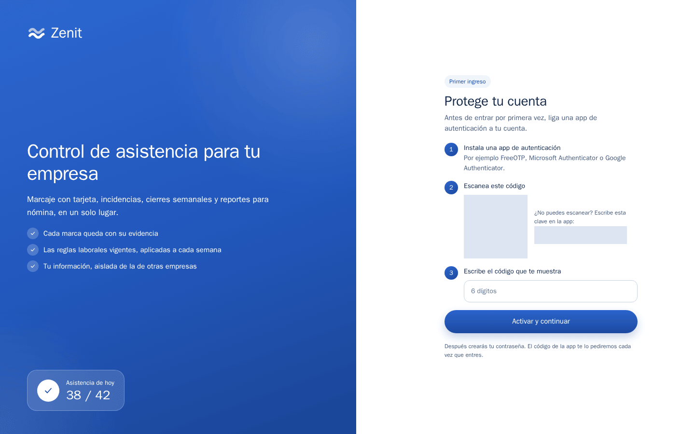

1. Escanear el QR con la app de autenticación del teléfono de quien presenta
   y escribir el código de seis dígitos. «Activar y continuar».
2. Crear la contraseña definitiva.
3. Guardar los códigos de recuperación (sirven si se pierde el teléfono) y
   confirmar. Entra al Panel como Sofía.

Qué decir: nadie entra sin segundo factor, tampoco la primera vez; la
contraseña temporal sólo sirve para llegar a esta pantalla. Cerrar la
ventana privada.

**Entrada de todos los días.** Entrar con `demo.administracion@zenit.example`:
correo y contraseña, y luego el código de la app.

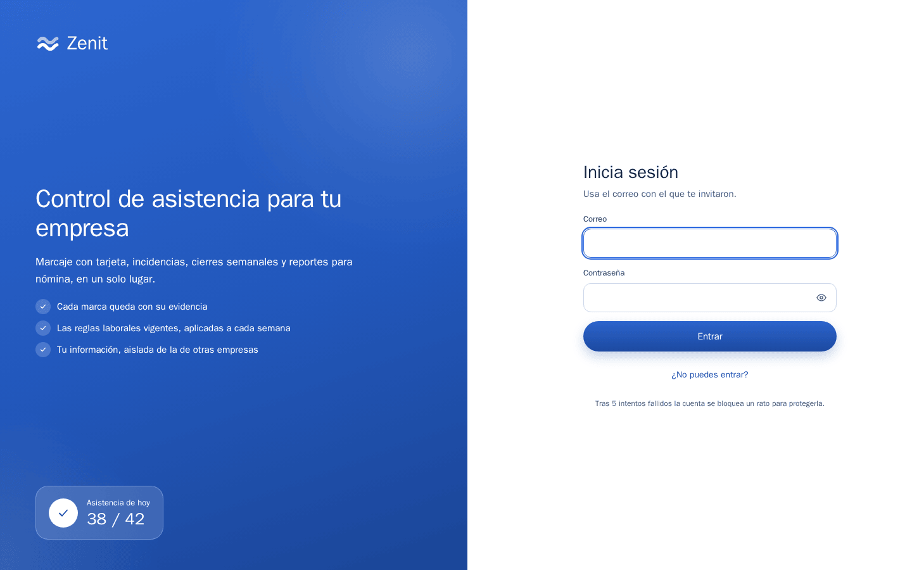

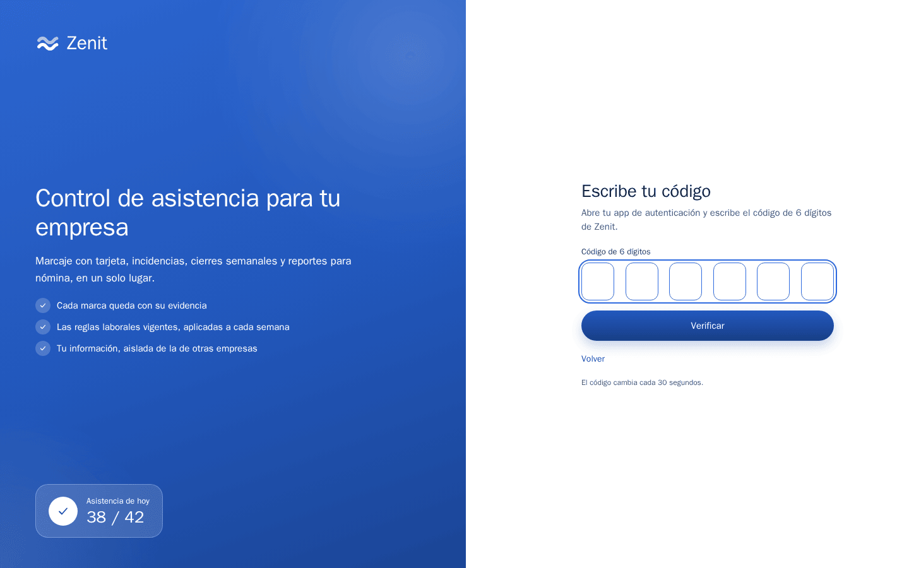

Qué decir: cada empresa ve sólo lo suyo; un código ya usado no vuelve a
servir.

## 2. Panel

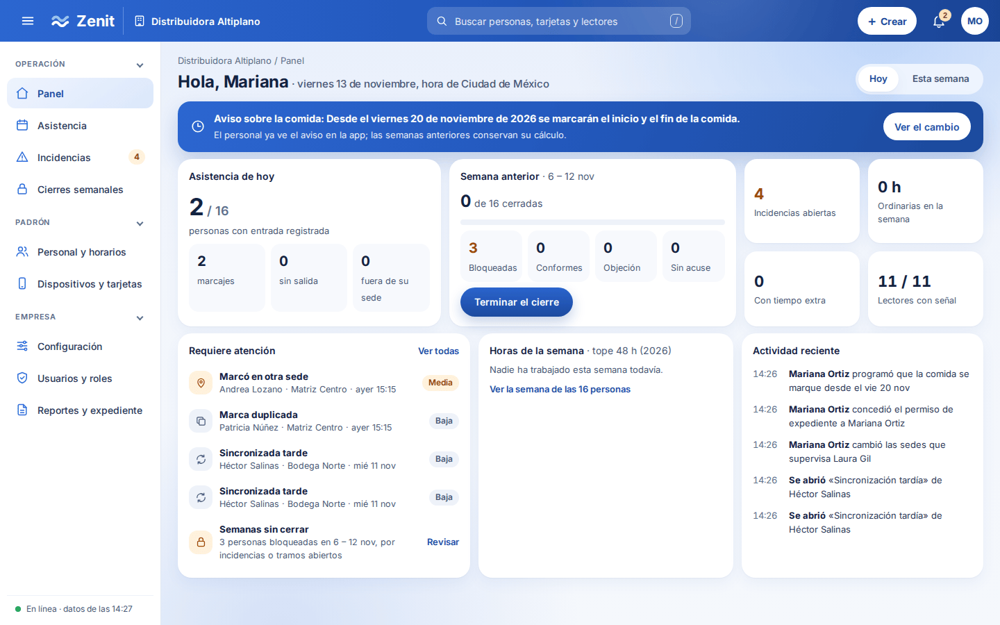

- **Asistencia de hoy**: cuántas personas ya marcaron entrada; sube en vivo
  en la parte 7.
- **Semana anterior**: cuántas semanas están listas para cerrar y cuántas
  bloqueadas.
- **El aviso de la comida**: un cambio de reglas con fecha de inicio; el
  personal lo ve en la app y las semanas anteriores conservan su cálculo.
- La campana y el número en Incidencias: lo pendiente de atender.

El mismo portal en el teléfono, sin instalar nada:

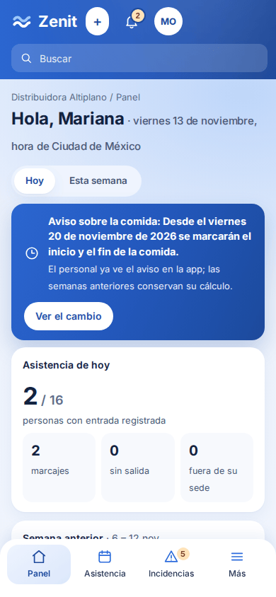

## 3. Asistencia

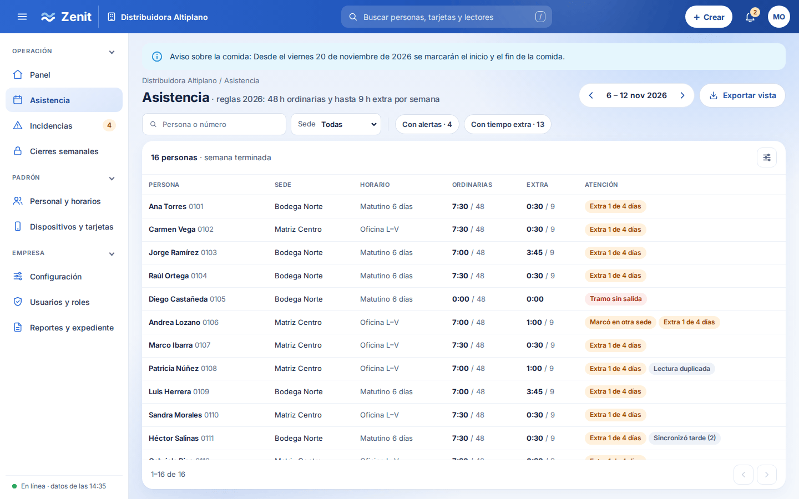

La semana de cada persona, día por día, con su horario. Abrir a **Jorge
Ramírez** (semana anterior):

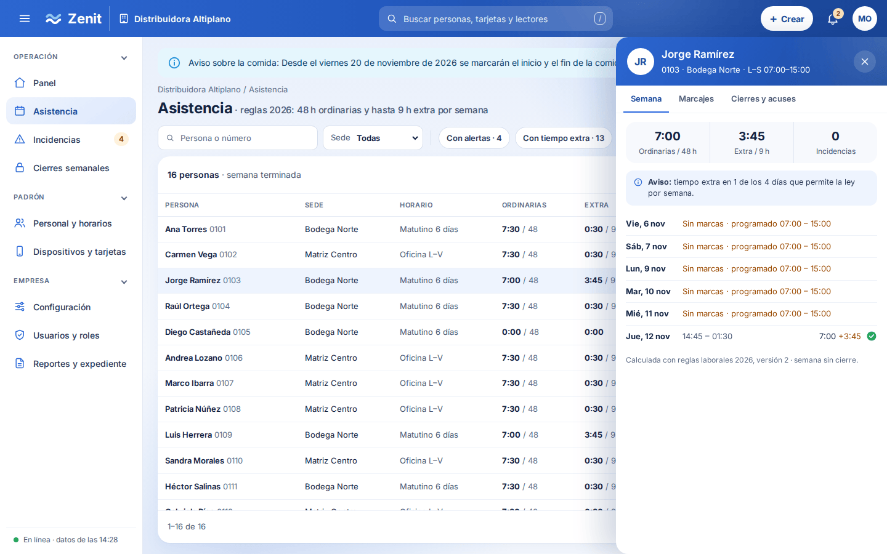

Qué decir: ayer trabajó casi 11 horas; Zenit separa las ordinarias (el
máximo diario según el tipo de jornada) y el resto como extra, con las
reglas laborales vigentes y sin contar dos veces el extra diario y el
semanal. Cada marca dice de qué terminal o teléfono vino, con qué tarjeta y
si estaba dentro de la sede.

> Las capturas de esta guía se tomaron con una siembra de la tarde: por eso
> muestran media hora extra para todos. Con el reinicio de la mañana, una
> jornada de 8 horas sale sin extra.

## 4. Incidencias

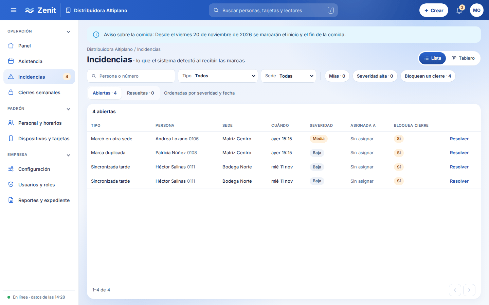

Lo que el sistema detectó al recibir las marcas, ordenado por severidad.
Abrir **Marcó en otra sede · Andrea Lozano**:

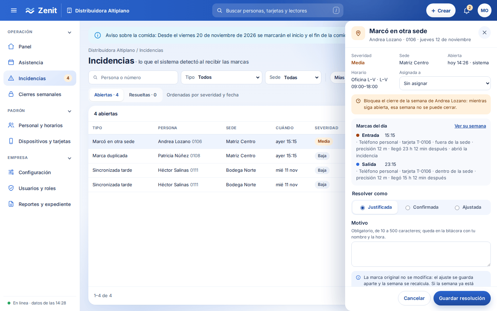

1. Ver sus marcas del día: la entrada se registró fuera de la sede.
2. Resolver como **Justificada**, con un motivo, por ejemplo «Visita a un
   cliente autorizada por su jefe».
3. «Guardar resolución».

Qué decir: la marca original nunca se modifica; la resolución queda aparte,
con nombre y hora, y la semana se recalcula. Mientras una incidencia que
bloquea siga abierta, esa semana no se cierra.

## 5. Cierres semanales

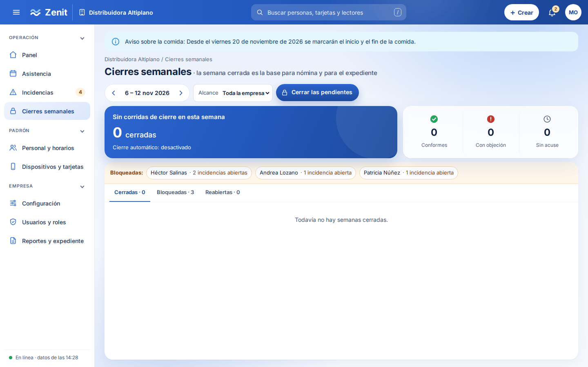

La semana anterior, lista para cerrarse. «Cerrar las pendientes»:

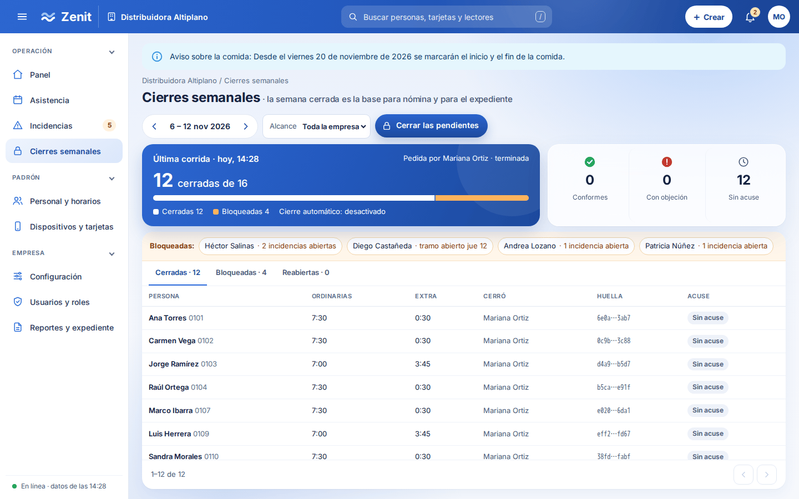

Qué decir:

- La semana cerrada es la base de la nómina y del expediente; cada cierre
  lleva su huella para comprobar después que nada cambió.
- Las bloqueadas dicen por qué: Héctor con sus marcas tardías, Diego con la
  salida que falta, Patricia con la marca duplicada. Si Andrea se resolvió en
  la parte 4, ya entra.
- El acuse: cada persona responde si está conforme desde su teléfono (parte
  8). Si se equivocó algo, una semana se reabre con motivo.

## 6. Padrón

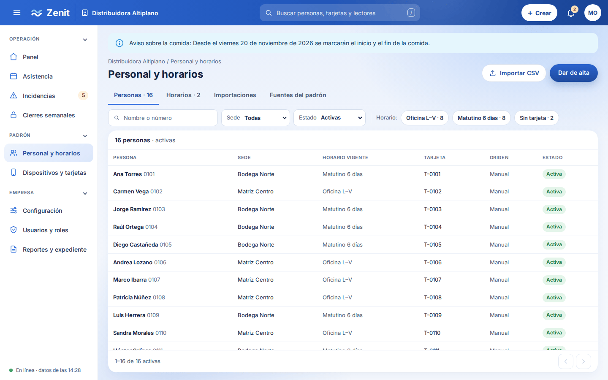

**Importar.** «Importar» y elegir `padron-demo.csv`:

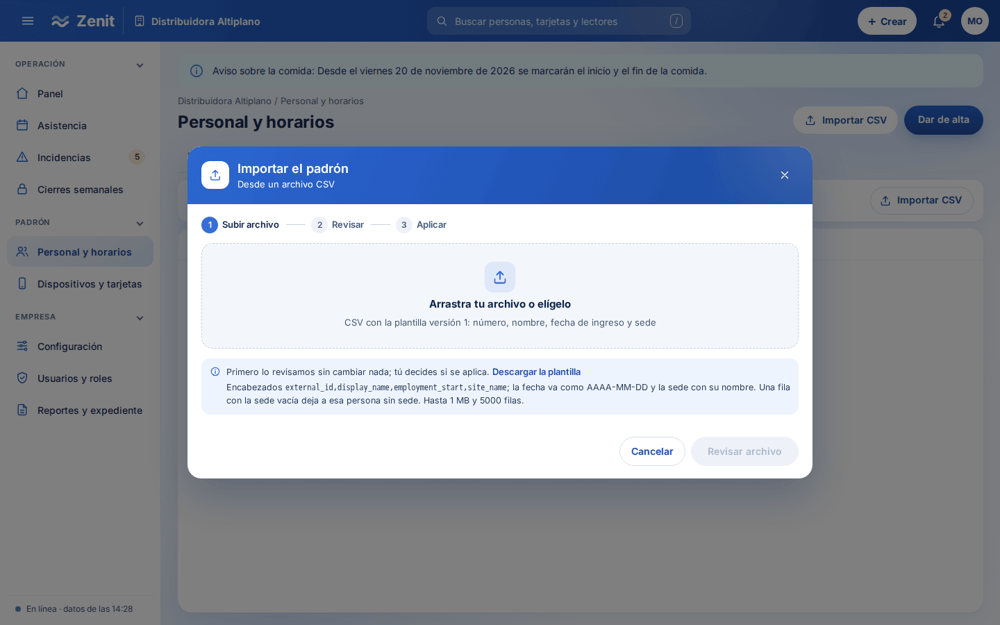

Primero se revisa sin cambiar nada. El archivo trae seis filas: cuatro
personas nuevas, Ana Torres sin cambios y Paula Gómez en «Sucursal Sur», una
sede que no existe. Zenit lo dice fila por fila y deja aplicar las que están
bien; las demás se descargan para corregirlas. Aplicar.

**Alta a mano.** «Crear» → «Dar de alta a una persona»: número de empleado
`0122`, **Carlos Medina**, sede Matriz Centro, fecha de ingreso de hoy y
horario Oficina L–V. La tarjeta se deja vacía: Carlos la recibe en la parte 7.

## 7. Terminal y tarjetas

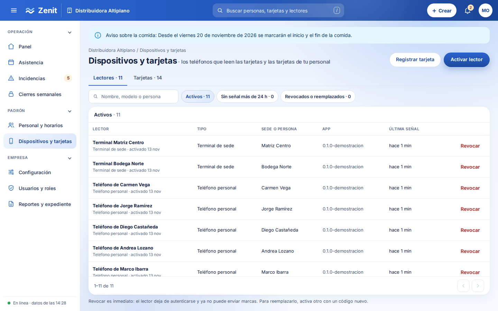

Los lectores activos: una terminal por sede y los teléfonos personales.

**Activar el teléfono A como terminal.** «Activar lector» → **Terminal de
sede** → Matriz Centro → «Generar código».

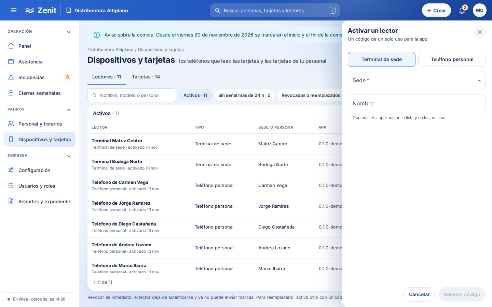

En el teléfono A: abrir Zenit → «Comenzar» → «Mi asistencia» →
«Continuar». En **Servidor** dejar `https://zenit.fastsolution.com.mx`,
escribir el **Código de vinculación** y «Vincular teléfono». La app queda
como terminal de Matriz Centro: «Aproxime una tarjeta NFC al lector».

Qué decir: el código vale una sola vez y unos minutos; el teléfono crea su
propia llave, que nunca sale de él. Hoy la terminal es un teléfono; el
alcance es una Raspberry con lector NFC.

**Preparar las tarjetas.** En el teléfono A, pestaña Dispositivo →
«Preparar una tarjeta». Acercar una tarjeta y mantenerla inmóvil hasta que
la app muestre su etiqueta `ZC-XXXXXXXX`. Escribirla en la tarjeta con el
marcador. Repetir con la segunda.

Qué decir: la tarjeta **no guarda datos de la persona**, sólo un código
firmado por el servidor y la clave de la empresa. Son tarjetas económicas
que se pueden copiar con equipo especial: por eso no llevan nada personal,
una tarjeta perdida se revoca en el portal y deja de marcar, y la geocerca
y la supervisión cuidan lo demás. Más adelante, tarjetas DESFire.

**Asignarlas.** En el portal, pestaña Tarjetas: las nuevas aparecen en
inventario. Asignar la primera a **Carlos Medina**. Para la segunda, abrir
la de **Ana Torres** y «Reponer con otra del inventario»: la anterior queda
reemplazada.

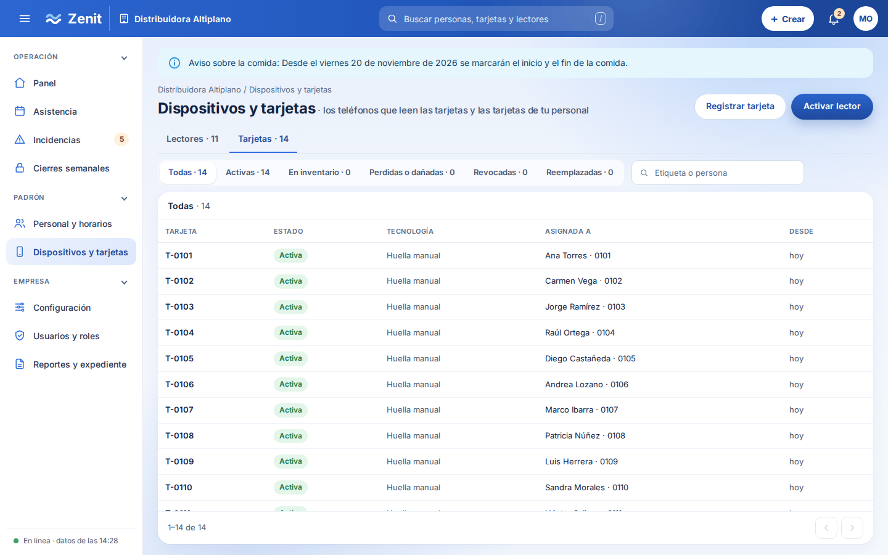

**Marcar en vivo.** Carlos acerca su tarjeta al teléfono A: el recibo dice
«aceptado». Abrir Asistencia o el Panel: Carlos ya tiene entrada hoy.

Las tarjetas sembradas (`T-0101` y siguientes, «Huella manual») son
simuladas: no existen en físico. La de Ana se repone por una real para
mostrar el reemplazo.

## 8. Teléfono personal

En el portal, «Activar lector» → **Teléfono personal** → Ana Torres →
«Generar código». En el teléfono B, vincular igual que el A.

En la app de Ana: **Mi semana** → la semana cerrada en la parte 5 →
«Responder al cierre» → «Estoy conforme» → «Confirmar respuesta».

En el portal, Cierres semanales: Conformes sube a 1.

Qué decir: el teléfono personal es de una persona y sólo ve lo suyo. Un
teléfono que funciona como terminal de sede no guarda datos de nadie: o la
sede tiene su terminal con tarjetas, o tiene una etiqueta NFC que escanean
los teléfonos personales (esa modalidad llega después del piloto).

## 9. Reportes

**Nómina.** Reportes y expediente → Reporte para nómina → la semana cerrada
→ contenido:

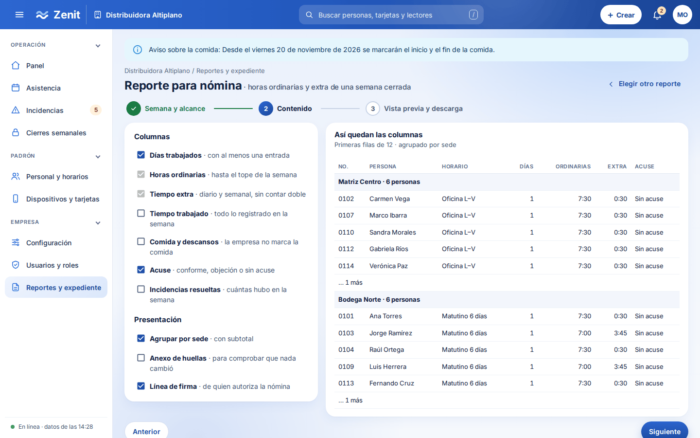

Vista previa y descarga:

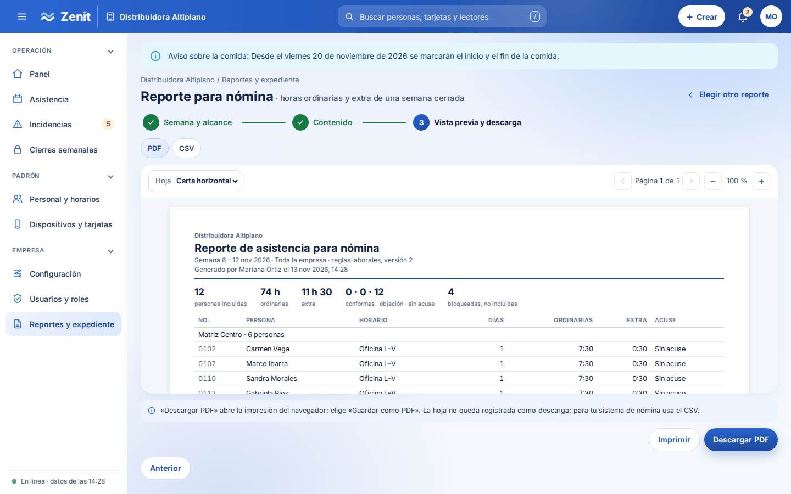

Qué decir: sólo entran semanas cerradas; las bloqueadas se listan aparte.
El PDF es para firmar; el CSV, para el sistema de nómina, y cada descarga
del CSV queda registrada.

**Bitácora.** Todo lo de la demostración quedó registrado: la resolución,
el cierre, la importación, las tarjetas y el acuse, con quién y cuándo.

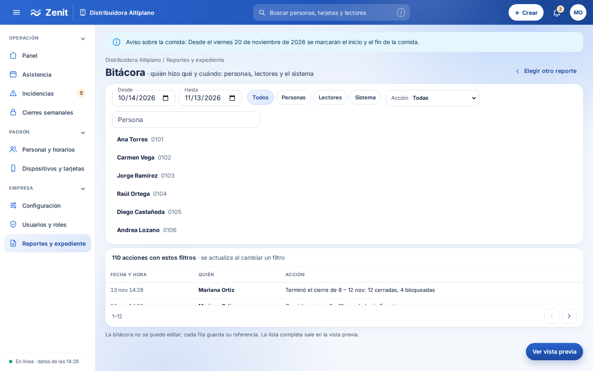

**Expediente.** La copia íntegra de la empresa en un ZIP con manifiesto y
huellas, para una auditoría o una inspección:

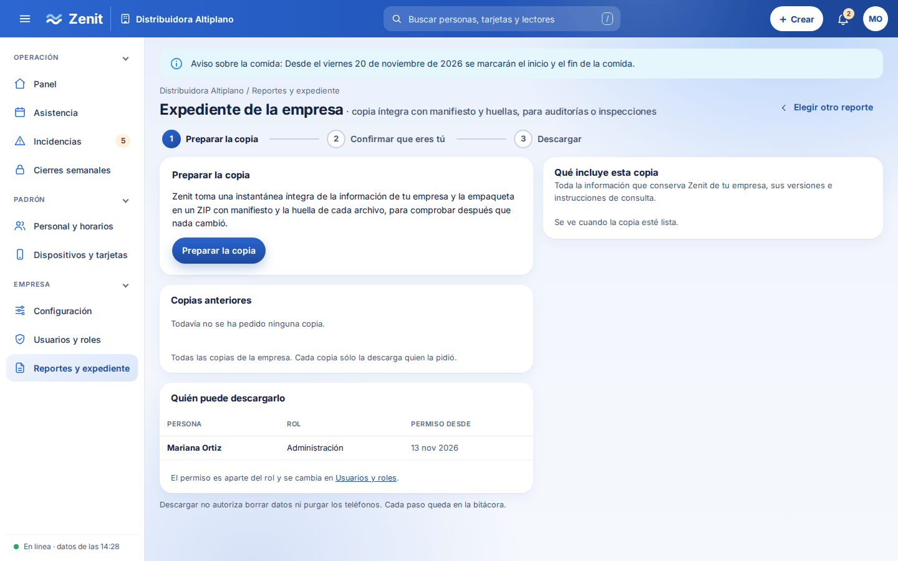

«Preparar la copia» → Zenit pide otra vez contraseña y código → descargar.
Sólo quien tiene el permiso, aparte del rol.

## 10. Supervisión

En una ventana privada, entrar con `demo.supervision@zenit.example`:

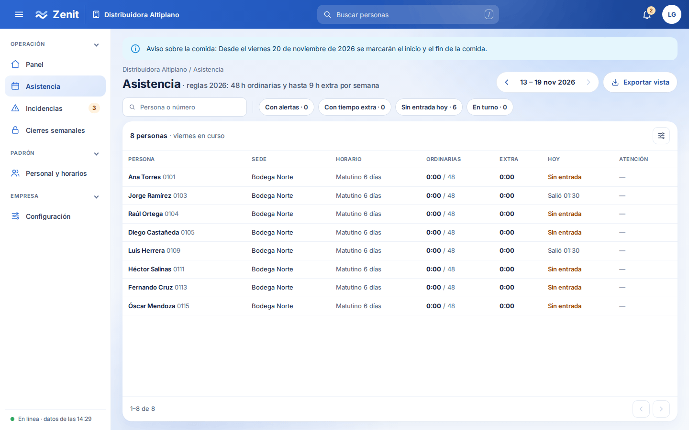

Laura Gil sólo ve Bodega Norte: su gente, sus incidencias y sus cierres.

## 11. Configuración

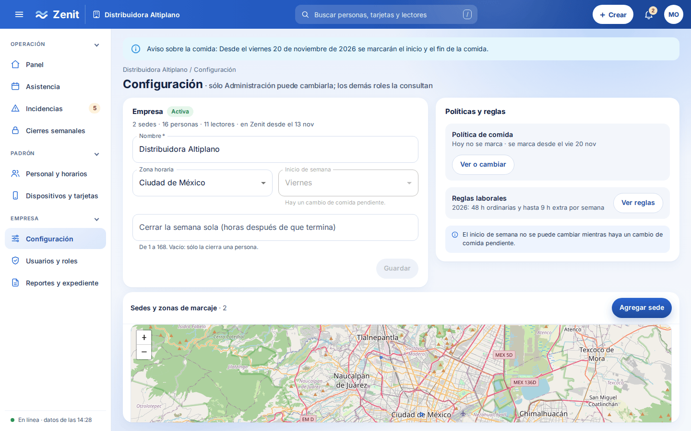

Sedes con su radio, horarios con vigencia, la regla de la comida y el
inicio de semana.

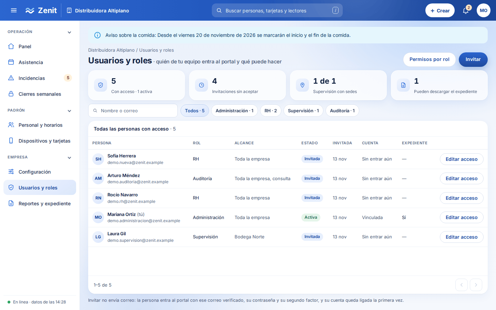

Quién entra al portal y con qué papel: Administración, RH, Supervisión
(por sede) y Auditoría (sólo consulta).

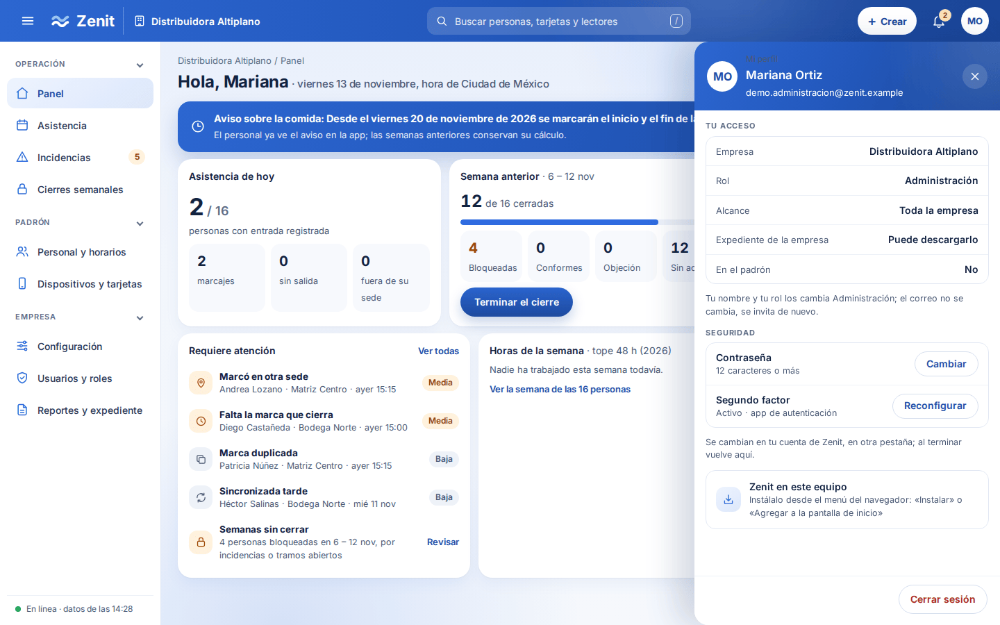

El perfil de cada cuenta: cambiar la contraseña y cerrar la sesión.

## Al terminar

```bash
bash deploy/servidor/demo/demo.sh reiniciar   # deja la empresa lista para otra demostración
bash deploy/servidor/demo/demo.sh limpiar     # o la borra, con sus cuentas
```

Después de un reinicio los teléfonos A y B ya no están vinculados: para la
siguiente demostración se vinculan con un código nuevo. Las tarjetas
preparadas siguen sirviendo para la siguiente demostración mientras el
servidor conserve su clave: se vuelven a dar de alta preparándolas otra vez
en una terminal.

## Si algo falla

| Qué pasa | Por qué | Qué hacer |
| --- | --- | --- |
| El código de la app de autenticación no entra | Ya se usó o la hora del teléfono está mal | Esperar el siguiente código; poner la hora automática |
| La cuenta nueva pide el código en vez del QR | Su primer ingreso ya se hizo | `demo.sh reiniciar`, o mostrar el primer ingreso con la captura |
| La marca en vivo sale «marcó en otra sede» | La sede no está donde se presenta, o el teléfono no tiene ubicación precisa | Poner `DEMO_LATITUD` y `DEMO_LONGITUD` y reiniciar; encender la ubicación precisa |
| La app rechaza la tarjeta sin mandar nada | La tarjeta no está preparada | Prepararla en la terminal |
| El recibo dice `card_unknown` | La tarjeta no tiene titular | Asignarla en Tarjetas |
| El código de vinculación no sirve | Venció o ya se usó | «Activar lector» de nuevo |
| Muchas incidencias «sincronizada tarde» | Se reinició la tarde anterior | Reiniciar la mañana de la demostración |
| La importación dice «la cuota por minuto se agotó» | Demasiadas peticiones seguidas | Esperar un minuto |

## Los comandos

`deploy/servidor/demo/demo.sh` corre todo en contenedores con versiones
fijas (Node y Chromium de Playwright 1.52.0) y entra al servidor con la
herramienta del despliegue.

| Comando | Qué hace |
| --- | --- |
| `preparar` | Una vez: cuentas, QR y clave de las tarjetas en `DEMO_SECRETOS`; instala la clave si el servidor no tiene |
| `reiniciar` | Borra la empresa de demostración y sus cuentas, las crea de nuevo y siembra la jornada de ayer |
| `estado` | Conteos de la empresa y si la clave de las tarjetas está presente, sin datos personales |
| `limpiar` | Borra la empresa y sus cuentas |
| `capturas` | Toma las capturas de esta guía; cierra la semana, así que después se reinicia |
| `pdf` | Genera `output/pdf/guia-de-demostracion.pdf` desde esta guía |

Lo que cuidan:

- **Sólo tocan la demostración**: la empresa `demo-altiplano` y las cuentas
  `demo.<algo>@zenit.example`. Cualquier otra empresa o cuenta queda fuera.
- **No imprimen secretos.** Las contraseñas, los secretos de los códigos y la
  clave de las tarjetas viven en `DEMO_SECRETOS`, fuera del repositorio. Lo
  que se sube al servidor va a una carpeta de 700 que se borra al terminar.
- **La clave de las tarjetas no se reemplaza**: cambiarla invalidaría las
  tarjetas ya preparadas.
- **La siembra usa el API** con la sesión de Administración y dispositivos
  que firman como la app; la base de datos sólo se toca para crear y borrar
  la empresa.

Los archivos:

| Archivo | Qué es |
| --- | --- |
| `demo.sh` | Los comandos |
| `en-servidor.sh` | Lo que corre dentro del servidor: borrar, crear cuentas y empresa, instalar la clave, conteos |
| `preparar.mjs` | Genera las cuentas, los QR y la clave |
| `sembrar.mjs` | Siembra sedes, horarios, personas, tarjetas, dispositivos y la jornada de ayer |
| `capturas.mjs` | Las capturas de esta guía |
| `pdf.mjs` | El PDF de esta guía |
| `comun.mjs` | Sesión en el portal, cliente del API y dispositivos simulados |
